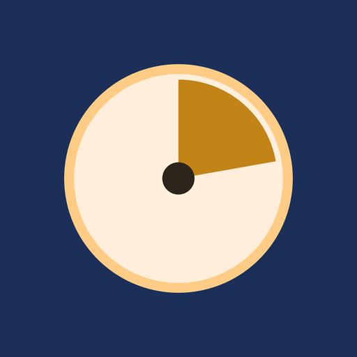

# Kairos



[](https://github.com/SKOHscripts/Kairos/actions/workflows/kmp.yml)
[](https://github.com/SKOHscripts/Kairos/releases/latest)
[](LICENSE)

[English](README.md) · **Français**

**Le bon moment pour chaque tâche.** Kairos répond à une question concrète :
« qu’est-ce que je fais maintenant, et dans quel ordre, sachant qu’une réunion
de 13 h à 14 h m’empêche de traiter le sujet urgent avant 14 h 05 ? » Il range
tes tâches dans l’ordre où les faire et les place dans les trous de ta
journée. Sans compte, sans publicité, sans réseau : tes données restent sur
ton appareil.

**Android, Windows, Linux, macOS, et dans le navigateur.**

<p>
  <a href="https://f-droid.org/packages/com.skohscripts.kairos/"></a>
  <a href="https://apps.obtainium.imranr.dev/redirect?r=obtainium://add/https://github.com/SKOHscripts/Kairos"></a>
  <a href="https://github.com/SKOHscripts/Kairos/releases/latest/download/Kairos-android.apk"></a>
  <a href="https://github.com/SKOHscripts/Kairos/releases/latest/download/Kairos-windows-x64.msi"></a>
  <a href="https://github.com/SKOHscripts/Kairos/releases/latest/download/Kairos-linux-x64.deb"></a>
  <a href="https://github.com/SKOHscripts/Kairos/releases/latest/download/Kairos-macos-arm64.dmg"></a>
  <a href="https://skohscripts.github.io/Kairos/app/"></a>
</p>

[Plus d’options sur la page de téléchargement](https://skohscripts.github.io/Kairos/)

## En bref

- Il classe les tâches du jour par un score de priorité, affiché sur chacune,
  et explique ce score en un toucher.
- Il pose chaque tâche dans les trous de l’agenda, autour des réunions, avec
  une marge après chacune.
- Il protège des blocs de deep work et allège le creux de l’après-midi.
- Il chronomètre le temps réel, alerte en cas de dépassement, de chrono
  oublié ou de pause à prendre, et compare tes estimations au temps passé.

Le score de priorité vient de la méthode WSJF (« Weighted Shortest Job First ») :

```
              valeur(priorité) + criticité(échéance)
  score  =  ──────────────────────────────────────────
                   effort (points de Fibonacci)
```

- `valeur(priorité)` est exponentielle : `4^(2 − p)`, donc P0 = 16, P1 = 4, P2 = 1.
- `criticité(échéance)` monte en rampe à l’approche de l’échéance, ou de la
  date programmée si elle est plus proche. Une tâche en retard reste un palier
  à part : elle passe toujours devant, hors score.
- `effort` est la taille en points de Fibonacci (1 à 21).

Le petit et prioritaire passe donc devant le gros et lointain. Tous les poids
se règlent dans les **Réglages**.

> **Pourquoi « Kairos » ?** En grec, *καιρός* désigne le moment opportun,
> l’instant juste où agir, par opposition à *Chronos*, le temps qui défile.
> C’est le métier de l’outil : trouver le bon créneau pour chaque tâche. Nom de
> code : **14h55**, le creux post-déjeuner, l’heure la moins productive de la
> journée.

## Installer

La [page de téléchargement](https://skohscripts.github.io/Kairos/) propose le
bon fichier pour ton système. Tous les fichiers, et leurs sommes de contrôle
(`SHA256SUMS`), sont aussi dans les
[releases GitHub](https://github.com/SKOHscripts/Kairos/releases).

<p>
  <a href="https://f-droid.org/packages/com.skohscripts.kairos/"></a>
  <a href="https://apps.obtainium.imranr.dev/redirect?r=obtainium://add/https://github.com/SKOHscripts/Kairos"></a>
  <a href="https://github.com/SKOHscripts/Kairos/releases/latest/download/Kairos-android.apk"></a>
  <a href="https://github.com/SKOHscripts/Kairos/releases/latest/download/Kairos-windows-x64.msi"></a>
  <a href="https://github.com/SKOHscripts/Kairos/releases/latest/download/Kairos-linux-x64.deb"></a>
  <a href="https://github.com/SKOHscripts/Kairos/releases/latest/download/Kairos-macos-arm64.dmg"></a>
  <a href="https://skohscripts.github.io/Kairos/app/"></a>
</p>

| Système | Fichier | Remarque |
|---|---|---|
| Android 8 ou plus récent | `Kairos-android.apk`, ou [F-Droid](https://f-droid.org/packages/com.skohscripts.kairos/) | Le même APK signé que sur F-Droid : on passera de l’un à l’autre sans désinstaller. |
| Windows 10 ou 11 | `Kairos-windows-x64.msi` | Installation pour l’utilisateur courant, sans droit administrateur. |
| Windows, poste verrouillé | `Kairos-windows-x64-portable.zip` | Dézipper, lancer `Kairos.exe` : rien n’est installé. Kairos propose ses raccourcis (menu Démarrer, Bureau). |
| Linux (x86-64) | `Kairos-linux-x64.deb`, ou `Kairos-linux-x64-portable.tar.gz` | Version portable : Kairos propose de s’ajouter au menu des applications, avec son icône. |
| macOS | `Kairos-macos-arm64.dmg` (Apple Silicon), `Kairos-macos-x64.dmg` (Intel) | |
| Navigateur | [Kairos en ligne](https://skohscripts.github.io/Kairos/app/) | Edge ou Chrome récents ; rien à installer. |

**Première installation.**

- **macOS** : l’application n’est pas notariée par Apple. Au premier lancement,
  clic droit sur Kairos, « Ouvrir », puis confirmer.
- **Windows** : SmartScreen peut afficher « Windows a protégé votre
  ordinateur » : « Informations complémentaires », puis « Exécuter quand même ».
- **Android** : autoriser l’installation depuis le navigateur ou le
  gestionnaire de fichiers quand Android le demande (inutile depuis F-Droid).

**Mises à jour.** Sur Android, par F-Droid ou un nouvel APK ; avec un APK
installé à la main, Réglages → Général → Mises à jour montre ta version et « Voir
la dernière version » ouvre la page de téléchargement (Kairos ne se connecte
toujours pas). Sur
le bureau, Kairos vérifie toutes les 6 heures s’il existe une nouvelle version
et l’annonce dans un bandeau (« Télécharger » ouvre sa page) ; réglage dans
Réglages → Général → Mises à jour. La version web est toujours la dernière.

## Fonctionnalités

### Notes (capture)

Un écran pour se décharger l’esprit sans réfléchir à la structure : un seul
champ de texte libre, aucune priorité ni échéance à choisir sur le moment
(Ctrl/Cmd+Entrée capture sans lâcher le clavier). Quand une idée est prête,
**« → Tâche »** la convertit : la première ligne devient le titre, le reste la
description, et la tâche arrive dans « À traiter ». La note est archivée,
jamais perdue. Une note peut aussi être modifiée, archivée sans suite ou
supprimée.

### Tâches

- **Capture en une ligne** : la tâche arrive dans « À traiter », le champ
  reste prêt pour la suivante.
- **Édition complète** : titre, description, priorité, points, échéance, date
  programmée, projet, durée estimée, type, récurrence, heure fixe, lien,
  sous-tâches, bloqueurs. Un seul « Enregistrer ». Les champs date ont un
  sélecteur de date, des raccourcis (aujourd’hui, demain, lundi prochain, dans
  une semaine) et une saisie souple (`2026-9-30`, ou `30/09/2026`).
- **Sous-tâches modifiables** : la fiche d’une tâche liste ses sous-tâches pour
  les renommer, les cocher ou les supprimer, en plus d’en ajouter.
- **Raccourcis clavier** (bureau et web) : `N` pour capturer, `/` pour
  chercher.
- **Sous-tâches** : avancement n/m sur la mère ; seules les feuilles sont
  planifiées.
- **Récurrence** : quotidienne, jours ouvrés, hebdomadaire, mensuelle (terminer
  une occurrence crée la suivante), et « le N du mois » (décalée au jour ouvré
  précédent si week-end ou férié).
- **Mois sautés** : si Kairos n’a pas été ouvert pendant un mois entier, une
  tâche « le N du mois » n’a pas d’occurrence ce mois-là. La vue Jour
  d’aujourd’hui le dit alors, une ligne par série (« 2 occurrences mensuelles
  ont été sautées : Note de frais ») : les recréer (déjà en retard) ou les
  ignorer, avec annulation. Rien n’est recréé sans demander.
- **« Décaler »** : atterrit toujours sur un jour ouvré, et la tâche quitte
  « Aujourd’hui » jusque-là. **« Déplacer… »** programme une tâche pour un
  autre jour (demain, lundi prochain, dans une semaine, ou une date au choix)
  et propose d’annuler.
- **Bloqueurs** : après avoir bloqué une tâche, Kairos dit où elle est allée
  (« Bloquées » s’ouvre) ; la tâche qui bloque porte un badge « Bloque … ».

### « À traiter »

Une tâche n’entre dans le tri qu’une fois sa **priorité** et ses **points**
posés, en un toucher sur des pastilles qui disent ce que vaut chaque choix
(**P0 Critique**, **P1 Important**, **P2 Utile** ; de « 1 trivial » à
« 21 énorme »). « Comment qualifier ? » rappelle la règle.

### Ordonnancement

- **Score** affiché sur chaque tâche ; **« Pourquoi à cette place ? »** détaille
  le calcul : ce que vaut la priorité, ce que l’échéance ajoute, l’effort qui
  divise le tout.
- **Placement** : les tâches sont posées dans les trous de la journée avec
  leur durée, une marge après chaque réunion, le débordement signalé. Une
  tâche **épinglée** à une heure n’est jamais déplacée ; un conflit est
  signalé. Une tâche **programmée** plus tard reste masquée, sauf si son
  échéance approche.
- **Points de Fibonacci** : une taille relative (1, 2, 3, 5, 8, 13, 21). Le
  guide « Comment estimer les points ? » montre, pour chaque palier, le temps
  réel médian de tes propres tâches terminées et deux exemples ; l’édition
  suggère une durée d’après ton historique.
- **Noms des niveaux** (Réglages → Planification) : appelle les priorités et
  les points avec tes mots (« Urgent », S/M/L…). Le badge montre ton nom, la
  fiche et le guide le montrent avec sa valeur (« M (3) ») ; P0 reste rouge et
  Kairos calcule toujours avec les valeurs.
- **Creux de l’après-midi (14h55)** : pendant une fenêtre réglable (13 h → 16 h
  par défaut), Kairos évite d’y placer les tâches complexes et y fait remonter
  les légères. Les échéances et le chemin critique priment toujours ; le score
  affiché ne change pas.
- **Horaires par jour de la semaine** (Réglages) : chaque jour peut garder la
  journée de travail habituelle, avoir ses propres heures, ou être un jour libre
  où rien n’est planifié automatiquement (les tâches épinglées gardent leur
  heure). Rien ne change tant que tu n’en règles pas un.
- **Plusieurs plages et contextes** (Réglages) : un jour peut avoir plusieurs
  plages de travail (matin, soir…), et une plage peut être réservée à un
  contexte (« Travail », « Maison ») qui regroupe des types de tâche. Une tâche
  ne va que dans une plage de son contexte ; une tâche sans contexte va
  partout, et un contexte sans plage ce jour-là le dit sur ses tâches. Rien ne
  change tant que tu n’en règles pas.
- **Durées apprises** : une tâche sans estimation reprend la médiane du temps
  réellement passé sur ses dernières occurrences chronométrées (une tâche
  récurrente, ou des tâches de même titre) dès qu’il y en a assez. Elle
  s’affiche `~45 min` avec sa source dans « Pourquoi à cette place ? », et une
  estimation saisie l’emporte toujours. On peut la couper ou la régler dans les
  Réglages.
- **Jours ouvrés et fériés** : calendrier français intégré, dates
  supplémentaires dans les Réglages.

### Dépendances

« Bloqué par » : une tâche dont un bloqueur est encore à faire sort du planning
(section « Bloquées », levée automatique). Un bloqueur d’une tâche urgente
remonte dans l’ordre (chemin critique). Les cycles sont refusés.

### Créneaux et deep work

- **Créneaux occupés** (réunions, déjeuner…), ponctuels ou récurrents
  (quotidien, jours ouvrés, hebdomadaire), modifiables et supprimables.
- **Créneaux « jours ouvrés » sans les fériés** : un créneau « jours ouvrés »,
  comme le point quotidien, saute les jours fériés et les jours de repos
  ajoutés, comme une tâche « jours ouvrés ».
- **Créneaux mensuels, un jour à part** : un créneau peut revenir chaque mois,
  un jour donné (« le 15 », ramené au jour ouvré précédent comme une tâche
  mensuelle) ou un jour de la semaine (« le 3e mardi », « le dernier vendredi »).
  Sur tout créneau récurrent, « Seulement celle-ci » saute ce jour ou en change
  le titre et les heures pour ce jour seulement ; « Rétablir » remet la série.
- **Import de calendrier** : Réglages → Données → Calendriers → « Importer un
  calendrier… » (ou Importer) lit un fichier `.ics` (Outlook, Google Agenda,
  Thunderbird, Nextcloud…). Un aperçu vient d’abord ; chaque événement devient
  un créneau occupé en lecture seule dans ton fuseau horaire (événements répétés
  dépliés sur les 6 prochains mois, annulés et « disponible » écartés, provisoires
  gardés, titres masquables), et ceux sur la journée entière un badge sur le
  jour, sans bloquer de temps. La description, le lieu et les participants ne
  sont jamais gardés. « Réimporter » remplace les créneaux du calendrier à
  partir d’aujourd’hui, jamais les tiens ; « Retirer » l’enlève tout entier ; un
  créneau importé se supprime seul. Ni réseau, ni compte.
- **Calendriers du téléphone** (Android) : Réglages → Données → « Utiliser les
  calendriers du téléphone » montre les événements des calendriers cochés
  (Google, Exchange, DAVx⁵, ICSx⁵, Outlook avec « Synchroniser les
  calendriers ») en créneaux occupés en lecture seule, lus en direct, jamais
  stockés ni exportés. Kairos ne demande l’accès au calendrier qu’à ce moment
  (une permission facultative, pas une permission réseau).
- **Deep work** : un créneau réservé à une seule tâche, la plus urgente ; les
  autres le contournent.
- **Frise** de la journée : planifié, occupé, épinglé, deep work, conflits, et
  un rail du temps réellement chronométré.

### Temps réel et alertes

- **Chrono par tâche** (un seul à la fois), en direct sur la ligne, dans
  « Maintenant », la carte « En ce moment » et le titre de la fenêtre ; il
  survit à la fermeture de l’application et au redémarrage du téléphone.
- **Trois alertes** : dépassement de l’estimé, chrono oublié, pause
  suggérée. Un bandeau dans l’application, et une notification système :
  Android (notification permanente avec chronomètre, même application
  fermée), zone de notification du bureau, notification du navigateur.
- **Rappels** (Réglages, désactivés par défaut) : une notification quelques
  minutes avant une tâche à heure fixe et, si tu le veux, quand le plan passe à
  la tâche suivante. Sur Android même Kairos fermé (quelques minutes de retard
  possibles téléphone en veille, aucune permission de plus) ; sur le bureau et
  le web tant que Kairos est ouvert.
- **Récapitulatif du jour** (Réglages, désactivé par défaut) : une notification
  « Ta journée » à l’heure choisie, avec le nombre de tâches et de créneaux que
  le plan prévoit et les trois premières tâches avec leur heure ; rien un jour
  où rien n’est prévu. Un toucher ouvre la vue Jour.

### Vues

- **Jour** : « Maintenant », agenda ordonné, sections « À traiter »,
  « Bloquées », « Programmées plus tard », filtres, backlog, frise ; badge
  « traîne depuis N j » et bandeau de surcharge de P0. On peut regarder un
  autre jour.
- **Widgets de l’écran d’accueil** (Android) : « Maintenant » montre la tâche du
  moment, ses heures et la suivante, avec « Fait » (deux touchers pour
  confirmer), le chrono et la capture ; « Journée » liste la journée heure par
  heure, les échéances en tête et les tâches faites barrées. Aux couleurs de
  l’application, sans permission de plus ; un toucher ouvre la vue Jour.
- **Semaine** : sept jours (échéances, tâches programmées, tâches faites, créneaux), temps réel de
  la semaine par type.
- **Déplacer depuis la semaine** : toucher une tâche de la vue Semaine la
  déplace vers un autre jour (fériés et jours libres signalés), avec « Annuler ».
- **Mois** : la bascule « Mois » de la vue Semaine montre le mois entier, une
  case par jour avec le nombre de tâches prévues, un drapeau pour les échéances,
  un avertissement pour les journées trop chargées et une icône pour les fériés et
  jours libres, et la même information en listes dessous ; toucher un jour l’ouvre.
- **Statistiques** : débit hebdomadaire, calibration des estimations (temps
  réel médian par palier, biais), temps par type, flux, complétude. L’effectif
  est affiché ; un petit échantillon est marqué « peu fiable ».
- **Des statistiques à ta façon** : à resserrer par période (4, 8, 12 semaines
  ou tout) et avec la même recherche et les mêmes filtres que la vue Jour
  (type, projet, priorité…) ; rien n’est enregistré. « Exporter… » enregistre
  ce que l’écran montre : les tableaux dans un fichier CSV (prêt pour un
  tableur), ou une carte en image PNG avec sa date, sa période et son filtre.
- **Évolutions** (Statistiques) : le temps chronométré jour par jour (semaine
  par semaine au-delà de 8 semaines) et le biais d’estimation semaine par
  semaine, chaque graphique avec son résumé écrit et son effectif.
- **Corriger les estimations** (Statistiques) : remplace l’estimation de tâches
  terminées et chronométrées par le temps réellement passé, après un aperçu où
  l’on décoche celles à garder ; « Annuler » rend les anciennes estimations.
- **Quand tu travailles chaque type** (Statistiques) : pour chaque type de
  tâche, les tranches de 2 h où tu travailles vraiment (d’après tes sessions de
  chrono), comparées à ton rythme habituel. Cette carte observe seulement.
- **Tes heures les plus efficaces** (Statistiques) : pour chaque type, la
  tranche où tu le finis le plus vite au regard de tes estimations ; les
  Meilleures heures peuvent s’en servir (mesurer par l’efficacité, ou les deux).
- **Meilleures heures** (Réglages, désactivé par défaut) : le planning préfère,
  entre des tâches de score voisin, les heures où tu travailles d’habitude chaque
  type, celles où tu le finis plus vite que prévu, ou les deux (détectées avec le
  chrono, force Faible / Moyenne / Forte), ou l’heure préférée que tu donnes à un
  type. Les tâches en retard et l’urgence passent
  toujours avant ; la vue Jour dit quand cela a joué.

### Données

- Tout reste sur l’appareil : aucune connexion réseau (Android n’a même pas la
  permission), aucun compte.
- **Export et import** JSON (Réglages → Données) ; une sauvegarde automatique
  précède chaque import.
- Sur le bureau, le **dossier des données** peut changer (Réglages → Données →
  « Changer de dossier… », pour un dossier synchronisé ou chiffré) ou être fixé
  au lancement avec `--data-dir=<dossier>` ; il sert au prochain démarrage, et
  tes données sont copiées, jamais déplacées. Réglages → À propos →
  **Diagnostic** : un journal local facultatif (désactivé par défaut, sans le
  contenu de tes tâches) et « Copier le diagnostic » pour un rapport de bug.
  La vérification des mises à jour suit le proxy du système.
- **Fichier lié** : sur le bureau et Android aussi, Réglages → Données →
  « Créer un fichier » tient à jour une copie de tes données (un export, qui
  s’ouvre partout) dans le dossier de ton choix, par exemple un dossier
  Syncthing ou Nextcloud, écrite 2 secondes après chaque changement. Si un autre
  appareil a modifié le fichier, Kairos n’y écrit plus et te demande : écraser,
  l’importer ou délier.
- **Version web** : données enregistrées dans le navigateur, et, dans Edge ou
  Chrome, **liées à un fichier** tenu à jour à chaque modification.
- **Langues** : l’interface parle **anglais, français, espagnol, allemand, russe
  et italien**. Kairos suit la langue du système quand elle en fait partie
  (l’anglais sinon), ou celle que tu choisis dans Réglages → Général → Langue.
  Les dates, les heures et les nombres la suivent, ainsi que les tâches d’exemple
  d’une première installation. Une autre langue ? Voir
  [Traduire Kairos](#traduire-kairos).

### S’y retrouver

- Kairos s’ouvre sur la page **Accueil**, premier onglet de la navigation :
  elle rappelle à quoi sert Kairos et ce qu’il sait faire, avec un accès
  direct à chaque écran ; elle explique aussi comment travailler avec un
  manager ou une équipe.
- Les **Réglages** s’ouvrent par la roue crantée, en haut à droite de chaque
  écran.
- **Réglages par catégorie** : chaque catégorie a son icône et le résumé de ce
  qu’elle contient ; en fenêtre large, la liste et la catégorie sont côte à côte.
- Un bouton **« ? »** en haut de chaque écran : l’aide de l’écran où tu te
  trouves, l’accès à l’Accueil et à la visite guidée.
- Une **visite guidée** pas à pas (six étapes), proposée au premier
  lancement et à revoir quand on veut ; une seconde visite présente l’espace
  Équipe quand il est activé.
- **Première tâche guidée** : au premier lancement (ou depuis la vue Jour tant
  que tu n’as aucune tâche à toi), Kairos te guide dans la vraie fiche d’une
  tâche, champ par champ (titre, priorité, points de Fibonacci, estimation,
  dates, type, options avancées), puis te montre où elle se place dans la
  journée et te félicite une fois qu’elle est réellement créée. Rien n’est
  écrit si tu renonces.
- **Découvrir Kairos** : des chapitres sur chaque fonctionnalité (Réglages,
  aide ou Accueil), à rouvrir quand tu veux, et une section **« Nouveau dans
  cette version »** sur l’Accueil.
- **Le guide se souvient** : un chapitre lu jusqu’au bout est coché, « Nouveau
  dans cette version » reste masqué pour la version une fois fermé, et « Voir
  l’écran » défile jusqu’à l’endroit dont parle la carte et le met en valeur un
  instant. Réglages → À propos → « Revoir le guide depuis le début » fait tout
  revenir.
- **Récurrente et Réglages pas à pas** : dans « Découvrir Kairos », « Créer ma
  première tâche récurrente » te guide dans la vraie fiche et montre, pour
  chaque règle, la prochaine échéance qu’elle produirait ; « Régler Kairos pas à
  pas » passe par la journée de travail, les horaires, les contextes et les
  meilleures heures, une carte à la fois, et n’enregistre rien avant que tu
  appuies sur Enregistrer.

### Gestion d'équipe (facultative)

- À activer dans **Réglages → Équipe** ; désactivée, rien ne change dans
  Kairos. Activée, un sélecteur **Perso | Équipe** apparaît en haut.
- **Première tâche d’équipe guidée** : depuis « Découvrir Kairos » (espace
  Équipe activé), Kairos te guide dans la fiche d’une tâche d’équipe, champ par
  champ (titulaire et sa charge, priorité et taille, effort, échéance,
  catégorie), puis dit où la tâche est arrivée. Rien n’est écrit si tu renonces.
- **Membres** : quotité, heures par jour (ou des heures différentes du lundi
  au vendredi, un jour à 0 étant libre, pour une semaine de quatre jours),
  absences ; « C’est moi » fait
  apparaître dans votre vue Jour les tâches d’équipe qui vous sont
  assignées.
- **Backlog d’équipe** trié par le même score WSJF, catégories = types de
  tâche.
- **Assignation** et **réaffectation** des tâches aux membres, une à une ou en
  lot.
- **Suivi** : une ligne par membre (en cours, à faire, faites), avancement
  par pas de 10 %, signaux « en retard », « sans avancement », « ballottée »,
  limite de tâches en cours ; **historique** complet de chaque tâche.
- **Charge** : capacité de chacun (quotité, absences, jours fériés, taux de
  focus), charge et taux par membre, pour l’équipe et par catégorie, date
  de fin prévue de chaque tâche et échéances en danger ;
  **suggestion de répartition** du backlog, à accepter ligne à ligne.
- **Prévisions** par simulation (Monte Carlo) sur l’historique réel de
  l’équipe : date de fin à 50, 85 et 95 % de chances, probabilité de tenir
  chaque échéance, sujets les plus à risque, membre goulot, issue la plus
  probable ; **scénarios « Et si… ? »** (absence, renfort, réaffectation,
  tâches en plus…) comparés côte à côte, puis appliqués si on le souhaite.
- **Votre travail perso compte** : si un membre est « C’est moi », vos tâches
  personnelles entrent dans votre charge et vos prévisions d’équipe (marquées
  « Perso »), sans quitter l’espace Perso ; « Compter dans l’équipe » (fiche
  de la tâche, options avancées) en exclut une. Vos réunions de la vue Jour
  réduisent votre capacité, et les prévisions proposent « Mon travail ».
- Les prévisions et la charge tiennent compte des **tâches récurrentes**
  (chaque occurrence à venir sur l’horizon) et du **temps déjà passé** sur
  une tâche.
- **Échanges par fichier** avec les membres qui ont Kairos, réunis dans
  l’onglet **Échanges** de l’écran Équipe : « Envoyer ses tâches… » produit un
  paquet que le membre reçoit par **Importer** (ses tâches rejoignent sa
  journée, marquées « de <manager> ») ; il renvoie son avancement
  (« Renvoyer l’avancement… »), que le manager reçoit au même endroit et
  intègre après un aperçu. Pour chaque membre, l’onglet montre la date du
  dernier paquet et du dernier rapport, et signale « En attente de son
  rapport ». Chacun garde la main sur ses champs ; rien n’est supprimé sans
  qu’on le choisisse. Chaque tâche peut porter une **note** courte dans chaque
  sens (« Bloquée en attendant la clé d’API »), affichée avec son auteur et sa
  date et gardée dans l’historique de la tâche. Un membre peut aussi
  **proposer** une de ses tâches au manager : elle part avec le prochain
  rapport (titre, description, durée, type), et le manager l’ajoute au
  backlog, la refuse ou décide plus tard.
- Un seul utilisateur, le manager : tout reste sur l’appareil, sans compte
  ni réseau ; les fichiers circulent comme on veut (courriel, clé USB…).

### Soutenir

- Un **cœur** dans la barre du haut (et un bouton dans « À propos et guide »)
  ouvre la [page de don](https://skohscripts.github.io/donate.github.io/) de
  l’auteur. Kairos reste gratuit et identique pour tous.

### Apparence

- **Couleur du thème** au choix (Réglages → Général → Apparence) : l’océan par défaut,
  sept autres couleurs proposées (dont le miel, couleur du logo), ou une couleur libre (`#RRGGBB`). Tout le
  thème en est dérivé (Material Design 3), contrastes compris.
- Sur **Android 12 et plus**, « Couleurs du système » suit les couleurs du
  fond d’écran (Material You).
- **Thème sombre** : Kairos suit le système (sombre quand ton téléphone, ton
  ordinateur ou ton navigateur l’est). L’interrupteur « Thème sombre » (Réglages →
  Général → Apparence) choisit l’autre thème ; le rebasculer suit à nouveau le
  système. Les images exportées des statistiques restent claires.
- Au lancement, une **page de démarrage** (Android, bureau, web) : l’aiguille
  du cadran solaire fait un tour et se pose sur le logo, puis l’application
  apparaît en fondu. Un toucher l’abrège.

## Liste des fonctionnalités

Toutes les fonctionnalités en un tableau, dans l’ordre de la liste de l’application (Accueil →
« Liste de fonctionnalités »), avec la version qui l’a apportée et les plateformes où elle existe.

| Chapitre | Fonctionnalité | Depuis | Plateformes |
|---|---|---|---|
| Premiers pas | Capturer sans réfléchir | 3.0.0 | Toutes |
| Premiers pas | Raccourcis clavier | 3.0.0 | Bureau, Web |
| Premiers pas | Qualifier en un clic | 3.0.0 | Toutes |
| Premiers pas | Faire dans l’ordre | 3.0.0 | Toutes |
| Premiers pas | Découvrir Kairos | 3.4.0 | Toutes |
| Premiers pas | Créer ta première tâche | 3.4.0 | Toutes |
| Premiers pas | Le guide retient et montre l’endroit | 3.7.0 | Toutes |
| Premiers pas | Récurrente et Réglages pas à pas | 3.9.0 | Toutes |
| Planifier | Priorité, points et estimation | 3.0.0 | Toutes |
| Planifier | Noms des niveaux | 3.9.0 | Toutes |
| Planifier | Score | 3.0.0 | Toutes |
| Planifier | Placement dans la journée | 3.0.0 | Toutes |
| Planifier | Creux de l’après-midi | 3.0.0 | Toutes |
| Planifier | Plusieurs plages et contextes | 3.5.0 | Toutes |
| Planifier | Planifier autour de tes meilleures heures | 3.6.0 | Toutes |
| Planifier | Horaires par jour de la semaine | 3.4.0 | Toutes |
| Planifier | Jours ouvrés et fériés | 3.0.0 | Toutes |
| Suivre | Frise de la journée | 3.0.0 | Toutes |
| Suivre | Suivre le temps | 3.0.0 | Toutes |
| Suivre | Trois alertes du chrono | 3.0.0 | Toutes |
| Suivre | Durées apprises | 3.4.0 | Toutes |
| Suivre | Quand tu travailles chaque type | 3.5.0 | Toutes |
| Suivre | Tes heures les plus efficaces | 3.9.0 | Toutes |
| Suivre | Ta journée sur l’écran d’accueil | 3.12.0 | Android |
| Suivre | Planifier la semaine | 3.0.0 | Toutes |
| Suivre | Le mois d’un coup d’œil | 3.8.0 | Toutes |
| Suivre | Déplacer une tâche depuis la semaine | 3.7.0 | Toutes |
| Suivre | Semaine et statistiques | 3.0.0 | Toutes |
| Suivre | Voir les choses évoluer | 3.8.0 | Toutes |
| Suivre | Corriger ses estimations | 3.8.0 | Toutes |
| Suivre | Des statistiques à ta mesure | 3.7.0 | Toutes |
| Organiser | Sous-tâches | 3.0.0 | Toutes |
| Organiser | Sous-tâches modifiables | 3.3.0 | Toutes |
| Organiser | Récurrence | 3.0.0 | Toutes |
| Organiser | Mois sautés | 3.13.0 | Toutes |
| Organiser | Décaler et déplacer | 3.0.0 | Toutes |
| Organiser | Bloqueurs | 3.0.0 | Toutes |
| Organiser | Créneaux occupés | 3.0.0 | Toutes |
| Organiser | Deep work | 3.0.0 | Toutes |
| Organiser | Les créneaux des jours ouvrés sautent les fériés | 3.7.0 | Toutes |
| Organiser | Créneaux mensuels, et un seul jour à part | 3.8.0 | Toutes |
| Organiser | Importer tes réunions d’un agenda | 3.10.0 | Toutes |
| Organiser | Calendriers du téléphone | 3.10.0 | Android |
| Équipe | Première tâche d’équipe guidée | 3.8.0 | Toutes |
| Équipe | Les membres | 3.1.0 | Toutes |
| Équipe | Ton travail perso compte | 3.3.0 | Toutes |
| Équipe | Le backlog | 3.1.0 | Toutes |
| Équipe | Assigner | 3.1.0 | Toutes |
| Équipe | Le suivi | 3.1.0 | Toutes |
| Équipe | Charge de l’équipe | 3.1.0 | Toutes |
| Équipe | Les prévisions | 3.1.0 | Toutes |
| Équipe | Les échanges | 3.1.0 | Toutes |
| Réglages | Des réglages clairs, les valeurs par défaut à portée | 3.4.0 | Toutes |
| Réglages | Des réglages rangés par catégories | 3.7.0 | Toutes |
| Réglages | Des rappels avant l’heure | 3.8.0 | Toutes |
| Réglages | Ta journée en une notification | 3.12.0 | Toutes |
| Réglages | Couleur du thème | 3.1.0 | Toutes |
| Réglages | Thème sombre | 3.7.0 | Toutes |
| Réglages | Langues | 3.11.0 | Toutes |
| Réglages | Tes données et ton manager | 3.0.0 | Toutes |
| Réglages | Une copie de tes données dans un dossier synchronisé | 3.10.0 | Toutes |
| Réglages | Version web | 3.0.0 | Web |

## Réglages

Les réglages sont rangés par catégorie, chacune avec son icône et le résumé de
ce qu’elle contient : on en touche une pour l’ouvrir (en fenêtre large, la liste
et la catégorie sont côte à côte). Chaque réglage est expliqué sous son champ ;
un seul « Enregistrer » pour toutes les catégories (une modification est
gardée d’une catégorie à l’autre), et un champ invalide dit pourquoi : un
enregistrement refusé ouvre sa catégorie et y défile. Le score de priorité et
le creux de l’après-midi sont dans un groupe replié « Avancé : comment les
tâches sont ordonnées », et « Restaurer les valeurs par défaut » (Données)
remplit le formulaire des valeurs par défaut (l’espace Équipe n’est pas
touché ; rien n’est enregistré avant « Enregistrer »).

| Catégorie | Section | Réglages | Défaut |
|---|---|---|---|
| Général | Langue | Langue de l’interface (Système, Français, English, Español, Deutsch, Русский, Italiano) | Système |
| | Apparence | Couleur du thème (proposée, libre, ou du système sur Android 12+) | océan `#2F6FED` |
| | Apparence | Thème sombre (interrupteur à deux états) | suit le système |
| | Mises à jour (bureau) | Vérifier les nouvelles versions | activé |
| | Mises à jour (Android, APK installé à la main) | Version installée, « Voir la dernière version » | |
| | Raccourci (bureau, version portable) | Créer, mettre à jour ou retirer le raccourci | proposé au lancement |
| Journée et horaires | Journée de travail | Durée par défaut, marge après un créneau, début et fin | 30 min, 5 min, 9 h – 18 h |
| | Horaires par jour de la semaine | Comme d’habitude, personnalisé (une à quatre plages) ou jour libre | comme d’habitude |
| | Contextes | Jusqu’à quatre, chacun avec ses types de tâche | aucun |
| | Jours fériés | Calendrier français, dates supplémentaires | activé |
| Planification | Types de tâches | Liste des types | |
| | Noms des niveaux | Un nom par priorité et par palier de points (16 caractères au plus) | noms par défaut |
| | Meilleures heures | Préférer mes heures habituelles, force, mesurer par (fréquence, efficacité, les deux), heure préférée par type | désactivé, moyenne, fréquence |
| | Durées apprises | Activé, occurrences considérées, occurrences nécessaires | activé, 5, 3 |
| | Garde-fous | Seuils « traîne » (en retard, sans date), surcharge P0 | 7 j, 14 j, 5 |
| | Score de priorité (WSJF), avancé | Base de valeur, horizon et poids de l’urgence, points par défaut | 4, 14 j, 8, 3 |
| | Creux de l’après-midi, avancé | Activé, début, creux, fin, force | activé, 13 h – 15 h – 16 h, 1 |
| Chrono et statistiques | Alertes du chrono | Chrono oublié, pause suggérée, son de secours | 180 min, 50 min, désactivé |
| | Rappels | Tâches à heure fixe et avance, tâche suivante, récapitulatif du jour et son heure | désactivé, 10 min, désactivé, désactivé, 08:30 |
| | Statistiques | Fenêtre des indicateurs | 8 semaines |
| Équipe | Équipe | Gestion d’équipe, puis ses seuils, sa charge et ses prévisions | désactivé |
| Données | Données, calendriers, réglages par défaut | Export, import, importer un calendrier (réimporter, retirer), restaurer les valeurs par défaut | |
| | Dossier des données (bureau) | Changer de dossier…, revenir au dossier par défaut (prochain démarrage) | dossier du système |
| À propos | | Découvrir Kairos, À propos et guide, revoir le guide depuis le début | |
| | Diagnostic (bureau) | Tenir un journal de diagnostic, copier le diagnostic | désactivé |

## Traduire Kairos

L’interface existe en anglais, français, espagnol, allemand, russe et italien.
L’anglais et le français font référence ; l’espagnol, l’allemand, le russe et
l’italien ont été produits avec l’aide d’un modèle d’IA et n’ont pas été relus
par des locuteurs natifs : **les corrections sont les bienvenues**, de même qu’une
nouvelle langue écrite en alphabet latin ou cyrillique (portugais, néerlandais,
polonais, ukrainien…).

- Tous les textes sont dans
  [`kmp/ui/src/commonMain/composeResources/values-xx/strings.xml`](kmp/ui/src/commonMain/composeResources/values-es/strings.xml)
  (`values/` est l’anglais, la langue de repli) : un fichier par langue, les mêmes
  clés partout. Corrige un texte dans le fichier de ta langue, ou copie
  `values/strings.xml` dans `values-xx/` et traduis-le. Garde les paramètres
  (`%1$s`, `%1$d`) et l’apostrophe typographique `’` ; le test `StringsParityTest`
  le vérifie.
- Une nouvelle langue demande aussi quelques lignes de code (noms des mois, tâches
  d’exemple, nom dans la liste des langues) et une fiche de magasin : la liste
  des étapes est dans [`docs/spec/i18n.md`](docs/spec/i18n.md), section « Ajouter une langue ».
- Ouvre une pull request en anglais, ou une issue si tu préfères ne pas toucher au
  code : envoyer le fichier traduit suffit.
- Les langues dont l’écriture n’est pas couverte par la police embarquée (chinois,
  japonais, coréen, arabe, hébreu, hindi…) demandent plus de travail : voir
  l’[issue #147](https://github.com/SKOHscripts/Kairos/issues/147).

## Développement

Kairos 3 est écrit en **Kotlin Multiplatform** et **Compose Multiplatform**
(dossier `kmp/`) : un seul code pour Android, le bureau (JVM) et le web
(Kotlin/Wasm). Dépendances libres uniquement, versions figées dans
`kmp/gradle/libs.versions.toml`.

```bash
cd kmp
./gradlew :core:jvmTest :data:jvmTest :ui:jvmTest :desktopApp:jvmTest   # tests
./gradlew :desktopApp:run                                                 # application de bureau
./gradlew :desktopApp:run --args=--self-test=/tmp/captures                # rendu hors écran
./gradlew :androidApp:assembleRelease                                     # APK
./gradlew :webApp:wasmJsBrowserDistribution                               # version web
```

- Architecture, modules et décisions : [`docs/spec/architecture.md`](docs/spec/architecture.md) ;
  une spécification par domaine dans [`docs/spec/`](docs/spec/README.md).
- Charte graphique (Material Design 3, thème « océan ») :
  [`docs/DESIGN_SYSTEM.md`](docs/DESIGN_SYSTEM.md).
- Versions, releases et paquets : [`docs/spec/distribution.md`](docs/spec/distribution.md) ;
  F-Droid et page de téléchargement :
  [`docs/spec/publication.md`](docs/spec/publication.md).
- Règles de contribution : [`CLAUDE.md`](CLAUDE.md).

## Licence

[MIT](LICENSE).
