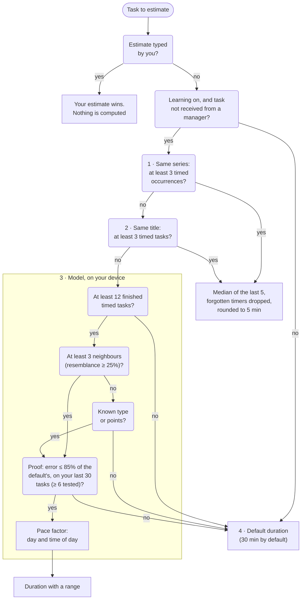

# Kairos


[](https://github.com/SKOHscripts/Kairos/actions/workflows/kmp.yml)
[](https://github.com/SKOHscripts/Kairos/releases/latest)
[](LICENSE)

**English** · [Français](README.fr.md)

**The right time for every task.** Kairos answers a concrete question: "what do
I do now, and in what order, given that a meeting from 1 pm to 2 pm keeps me
from handling the urgent topic before 2:05 pm?" It sorts your tasks into the
order to do them, fits them into the gaps of your day, and uses **on-device
machine learning** to learn how long they really take. No account, no ads, no
network: your data stays on your device.

**Android, Windows, Linux, macOS, and in the browser.**

<p>
  <a href="https://f-droid.org/packages/com.skohscripts.kairos/"></a>
  <a href="https://apps.obtainium.imranr.dev/redirect?r=obtainium://add/https://github.com/SKOHscripts/Kairos"></a>
  <a href="https://github.com/SKOHscripts/Kairos/releases/latest/download/Kairos-android.apk"></a>
  <a href="https://github.com/SKOHscripts/Kairos/releases/latest/download/Kairos-windows-x64.msi"></a>
  <a href="https://github.com/SKOHscripts/Kairos/releases/latest/download/Kairos-linux-x64.deb"></a>
  <a href="https://github.com/SKOHscripts/Kairos/releases/latest/download/Kairos-macos-arm64.dmg"></a>
  <a href="https://skohscripts.github.io/Kairos/app/"></a>
</p>

[More options on the download page](https://skohscripts.github.io/Kairos/en/)

## In short

- **New in 4.0: on-device machine learning learns how long your tasks really
  take.** A task with a new title gets a duration from your finished tasks
  that look like it, with a range and the list of those tasks, and only once
  this beats the default duration on your own history.
  [How it works](#on-device-machine-learning-how-long-your-tasks-really-take).
- **New in 4.0: sync between your devices.** Link the same file on each
  device, in a Syncthing or Nextcloud folder for example: Kairos merges it with
  each device's data, keeps everything from both sides, and lists what was
  changed on two devices at once. No account, no server, no network permission.
- It ranks the day's tasks with a priority score, shown on each one, and
  explains that score in one tap.
- It places each task in the gaps of the calendar, around meetings, with a
  buffer after each one.
- It protects deep-work blocks and eases the afternoon dip.
- It times the real work, alerts you when you go over the estimate, forget a
  running timer or need a break, and compares your estimates with the time
  actually spent.

The priority score comes from the WSJF method ("Weighted Shortest Job First"):

```
              value(priority) + criticality(deadline)
  score  =  ──────────────────────────────────────────
                    effort (Fibonacci points)
```

- `value(priority)` is exponential: `4^(2 − p)`, so P0 = 16, P1 = 4, P2 = 1.
- `criticality(deadline)` ramps up as the deadline approaches, or the scheduled
  date if that is closer. An overdue task stays a tier of its own: it always
  comes first, outside the score.
- `effort` is the size in Fibonacci points (1 to 21).

So small and important goes before big and distant. Every weight can be tuned
in **Settings**.

> **Why "Kairos"?** In Greek, *καιρός* means the opportune moment, the right
> instant to act, as opposed to *Chronos*, the time that flows by. That is the
> tool's job: finding the right slot for every task. Code name: **14h55**, the
> post-lunch dip, the least productive hour of the day.

## Why I built Kairos

**You capture. Kairos decides.**

To-do tools manage a list but do not sort it: the pile is endless. I merged
agile development, a to-do tool and the GTD method so that the list evolves by
itself: you focus on GTD, and Kairos tells you what to start with, so you can
unload your mind. No AI: local algorithmics that sharpen with use and always
point to the task to do **now**. From a Python script in a terminal to an app
for Android, Windows, Linux, macOS and the browser, rebuilt in Kotlin with
Claude Code.

**[Read the story of Kairos](https://skohscripts.github.io/Kairos/en/story/)**

## On-device machine learning: how long your tasks really take

New in 4.0: a machine-learning model that learns from your finished tasks how
long the next ones will take. It is trained and run entirely on your device:
nearest neighbours on your history, a ridge regression as a fallback, and a
check against your own data before it changes anything.

> **AI? No, machine learning.** No chatbot, no giant model, no cloud: just
> good old machine learning, robust and local, that trains on every task you
> finish. It keeps only your last 500 finished tasks and computes 200
> estimates in under a second (measured on every build). Your phone won’t even
> get warm.

- **By resemblance, with its proof.** A task you have never done before
  ("Quarterly report for the board") is compared with your finished tasks: words
  of the title, type, points, project. Its duration is the weighted median of
  the closest ones, with a range ("~45 min, between 30 and 60") and the list of
  those tasks, their real time and how similar they are. Without close tasks, a
  small regression on type and points takes over and says so.
- **Only once it has proven itself.** Kairos replays the model on your last 30
  finished tasks, without letting it see their real time, and applies it only
  if it clearly beats the default duration. Settings shows the result ("median
  error 12%, against 48% for the default duration"); otherwise the estimate is
  shown as "not reliable yet" and changes nothing.
- **Your pace.** If you are consistently slower on Monday mornings or faster in
  the evening, it learns that from your timed sessions and adjusts planned
  tasks ("Your pace: +20% on Monday").
- **It keeps you posted.** When finished tasks move the estimates of tasks to
  do, a banner (and at most one notification a day) says so, with before and
  after. Typed estimates the model clearly disagrees with are offered for
  review, never changed without you.
- **Everywhere the duration matters**: the day plan, the "Now" card, the
  overrun alert, triage in "To process", and team forecasts, where each
  model-estimated task is drawn within its own learned range.
- **Private and explainable by design.** No network, no pre-trained weights, no
  black box: only your own history, and the same result to the bit on Android,
  desktop and web. Measured on simulated histories, it cuts the median error on
  new titles by more than half, and when there is nothing to learn it stays
  within 10% of the default duration.
  It can be switched off in Settings.

### How the estimate is chosen

For a task without a typed estimate, Kairos walks down this path and stops at
the first level whose answer is **reliable**. A level that has something to say
but too few examples is shown as "not reliable yet", never applied, and the
search goes on.



- **What counts as an example.** Your finished tasks with at least 2 minutes of
  real time, in the same space (personal or team). A task received from a
  manager is never estimated this way.
- **Levels 1 and 2.** Median of the last 5 occurrences (Settings: "occurrences
  considered"), without those above 3 times the median (a forgotten timer),
  rounded to 5 minutes. Reliable from 3 examples (Settings: "occurrences
  needed"). A series follows a recurring task even if you rename it; titles are
  compared ignoring case and surrounding spaces.
- **Resemblance (level 3).** The title weighs half (whole words and groups of
  three letters), type 20%, points 20%, project tag 10%, counted only on what
  the task has filled in. The neighbours are the 5 closest, above 25%.
- **The proof.** The model is replayed on your last 30 finished tasks, each time
  trained only on older ones. At least 6 must be testable, and its median error
  must be at most 85% of the default duration's. If almost all your tasks last
  about the default duration, the model cannot beat it and stays off: nothing
  is lost.
- **Your pace.** A weekday or time-of-day factor, applied only to the model's
  estimates, only if it is learned from at least 8 timed sessions in that
  group, moves the estimate by at least 10% and measurably lowers the error. It
  needs a planned day (and a fixed time for the time-of-day part).

**What you can do to get the most out of it**

| You can | What it changes |
|---|---|
| **Time your tasks** with the timer | Everything is learned from finished, timed tasks: 3 are enough for a series or a title, the model starts at 12. |
| **Fill in type and points** | 20% of the resemblance each. The regression fallback needs points, or a type used on at least 3 tasks. |
| **Keep titles consistent** | Title words are half of the resemblance, and an identical title is picked up at level 2 without the model. |
| **Add a project tag** | 10% of the resemblance, when the task has one. |
| **Stop forgotten timers** | Durations above 3 times the median are ignored. |
| **Plan on dates, fix times** | The pace factor needs a planned day, and a fixed time for the time of day. |
| **Lower "occurrences needed"** | Levels 1 and 2 answer sooner (minimum 2), with less reliable estimates. The neighbours stay at 3 at least. |
| **Read the Settings line** | "Median error 12%, against 48% for the default duration" tells you whether the proof is passed. |

## Install

The [download page](https://skohscripts.github.io/Kairos/en/) offers the right
file for your system. All files, and their checksums (`SHA256SUMS`), are also
in the [GitHub releases](https://github.com/SKOHscripts/Kairos/releases).

<p>
  <a href="https://f-droid.org/packages/com.skohscripts.kairos/"></a>
  <a href="https://apps.obtainium.imranr.dev/redirect?r=obtainium://add/https://github.com/SKOHscripts/Kairos"></a>
  <a href="https://github.com/SKOHscripts/Kairos/releases/latest/download/Kairos-android.apk"></a>
  <a href="https://github.com/SKOHscripts/Kairos/releases/latest/download/Kairos-windows-x64.msi"></a>
  <a href="https://github.com/SKOHscripts/Kairos/releases/latest/download/Kairos-linux-x64.deb"></a>
  <a href="https://github.com/SKOHscripts/Kairos/releases/latest/download/Kairos-macos-arm64.dmg"></a>
  <a href="https://skohscripts.github.io/Kairos/app/"></a>
</p>

| System | File | Note |
|---|---|---|
| Android 8 or later | `Kairos-android.apk`, or [F-Droid](https://f-droid.org/packages/com.skohscripts.kairos/) | The same signed APK as on F-Droid: you can switch from one to the other without uninstalling. |
| Windows 10 or 11 | `Kairos-windows-x64.msi` | Per-user install, no administrator rights needed. |
| Windows, locked-down PC | `Kairos-windows-x64-portable.zip` | Unzip, run `Kairos.exe`: nothing is installed. Kairos offers to add its shortcuts (Start menu, Desktop). |
| Linux (x86-64) | `Kairos-linux-x64.deb`, or `Kairos-linux-x64-portable.tar.gz` | Portable version: Kairos offers to add itself to the applications menu, with its icon. |
| Arch Linux (x86-64) | [AUR `kairos-bin`](https://aur.archlinux.org/packages/kairos-bin): `yay -S kairos-bin` | Updated by your package manager (`yay -Syu`), like the rest of the system. |
| macOS | `Kairos-macos-arm64.dmg` (Apple Silicon), `Kairos-macos-x64.dmg` (Intel) | |
| Browser | [Kairos online](https://skohscripts.github.io/Kairos/app/) | Recent Edge or Chrome; nothing to install. |

**First install.**

- **macOS**: the app is not notarized by Apple, so macOS blocks it on first
  launch. Open System Settings → Privacy & Security and click "Open Anyway"
  next to Kairos, then confirm (up to macOS 14, right-clicking Kairos and
  choosing "Open" also works).
- **Windows**: SmartScreen may show "Windows protected your PC": click "More
  info", then "Run anyway".
- **Android**: allow installation from the browser or the file manager when
  Android asks (not needed from F-Droid).

**Updates.** On Android, through F-Droid or a new APK; with an APK installed
by hand, Settings → General → Updates shows your version and "See the latest
version" opens the download page (Kairos still never connects). On the desktop, Kairos
checks every 6 hours for a new version and announces it in a banner
("Download" opens its page); setting in Settings → General → Updates. Installed from the AUR,
Kairos leaves this to your package manager and never checks itself. The web version is
always the latest.

## Features

### Notes (capture)

A screen to empty your head without thinking about structure: a single free
text field, no priority or deadline to choose on the spot (Ctrl/Cmd+Enter
captures without leaving the keyboard). When an idea is ready, **"→ Task"**
converts it: the first line becomes the title, the rest the description, and
the task lands in "To process". The note is archived, never lost. A note can
also be edited, archived without follow-up, or deleted.

- **GTD explained**: Kairos follows GTD (capture, clarify, organize, reflect,
  engage). Each screen says which step it is, and "The GTD method" on Notes
  explains the five steps, where they are in Kairos and what Kairos does
  differently (it computes the order itself; Notes is also your "someday/maybe"
  list).

### Tasks

- **One-line capture**: the task lands in "To process", and the field stays
  ready for the next one.
- **Full editing**: title, description, priority, points, deadline, scheduled
  date, project, estimated duration, type, recurrence, fixed time, link,
  subtasks, blockers. A single "Save". Date fields come with a date picker,
  quick choices (Today, Tomorrow, Next Monday, In a week) and loose typing
  (`2026-9-30`, or `30/09/2026` in French).
- **Editable subtasks**: a task's sheet lists its subtasks so you can rename,
  check or delete them, on top of adding new ones.
- **Keyboard shortcuts** (desktop and web): `N` to capture, `/` to search.
- **Subtasks**: split a piece of work (where "Blocked by" chains separate
  ones; both sit in the task sheet's "Splitting and sequencing" section). Only
  the leaves are scheduled. A subtask is never less important than its parent
  (raising the parent raises it) and, without a due date of its own, is planned
  with the parent's; it never ends later. The parent shows n/m progress and the
  sum of its subtasks' durations and time spent; rows show the whole lineage
  ("A › C › D"). A switch chains new subtasks into a queue, in line order: each
  one waits for the previous one (the switch remembers your last choice).
- **Recurrence**: daily, weekdays, weekly, monthly (finishing an occurrence
  creates the next one), and "on day N of the month" (moved to the previous
  working day if it falls on a weekend or holiday).
- **Skipped months**: if Kairos was not opened for a whole month, a "day N of
  the month" task gets no occurrence for that month. Today's Day view then
  says so, one line per series ("2 monthly occurrences were skipped: Expense
  report"): recreate them (already overdue) or ignore them, with an undo.
  Nothing is recreated without asking.
- **Snooze and move**: a task row's calendar button first offers **"Move to
  the next working day"** (snooze: the deadline moves, always to a working
  day, and the task leaves "Today" until then), then dates to schedule it on
  (tomorrow, next Monday, in a week, or any date) without touching its
  deadline, with an undo.
- **Blockers**: after blocking a task, Kairos says where it went ("Blocked"
  opens); the blocking task shows a "Blocks …" badge. A search field finds the
  task to wait for in a long list.

### "To process"

A task only enters the ranking once its **priority** and **points** are set,
in one tap on chips that say what each choice means (**P0 Critical**,
**P1 Important**, **P2 Useful**; from "1 trivial" to "21 huge"). "How to
qualify?" recalls the rule. The **type** can be picked right there too. Once
priority, points and type are set, a task with no duration gets the median of
its type (or of its points) from your finished tasks, announced with "Undo"; a
duration you entered is never touched. In the team backlog, "To qualify" offers
the **category** the same way, and its estimate comes from finished team tasks
only.

### Scheduling

- **Score** shown on every task; **"Why this position?"** details the
  calculation: what the priority is worth, what the deadline adds, and the
  effort that divides it all.
- **Placement**: tasks are laid into the gaps of the day with their duration,
  a buffer after every meeting, and overflow flagged. A task **pinned** to a
  time is never moved; a conflict is flagged. A task **scheduled** for later
  stays hidden, unless its deadline approaches.
- **Fibonacci points**: a relative size (1, 2, 3, 5, 8, 13, 21). The guide
  "How to estimate points?" shows, for each level, the median real time of
  your own finished tasks and two examples; editing suggests a duration based
  on your history.
- **Split advice**: when your finished tasks show that a point level is poorly
  estimated (actual times spread more than ×2.5, estimates off by more than
  ×1.5, or fewer than 5 tasks to tell), the task sheet suggests splitting it
  into subtasks, with a button that opens the field. The threshold is yours:
  8 points can be reliable and 5 not. Never at 1 or 2 points.
- **Level names** (Settings → Planning): call the priorities and the points
  in your own words ("Urgent", S/M/L…). The badge shows your name, the sheet
  and the guide show it with its value ("M (3)"); P0 stays red and Kairos still
  computes with the values.
- **Afternoon dip (14h55)**: during an adjustable window (1 pm → 4 pm by
  default), Kairos avoids placing complex tasks there and pulls light ones up.
  Deadlines and the critical path always come first; the displayed score does
  not change.
- **Hours by day of the week** (Settings): each day can keep the usual working
  day, have its own hours, or be a day off where nothing is scheduled
  automatically (pinned tasks keep their time). Nothing changes until you set one.
- **Several windows and contexts** (Settings): a day can have several working
  windows (morning, evening…), and a window can be reserved for a context
  (“Work”, “Home”) that groups task types. A task only goes in a window of its
  context; a task with no context goes anywhere, and a context with no window
  that day says so on its tasks. Nothing changes until you set one.
- **Learned durations**: a task without an estimate takes the median real time
  of its last timed occurrences (a recurring task, or tasks with the same
  title) once there are enough of them. It shows as `~45 min` with its source
  in “Why this position?”, and an estimate you type always wins. It can be
  switched off, or tuned, in Settings.
- **Machine-learning estimates**: a machine-learning model trained on your
  device gives a task with a new title a duration from your finished tasks
  that look like it (words of the title, type, points), with a range (“between
  30 and 60 min”) and the list of those tasks with their real time. It only
  applies once it does better than the default duration on your own last
  tasks, which Settings shows. It learns your pace by day and time,
  tells you when estimates change, and offers to review typed estimates it
  disagrees with. Everything is computed on the device, from your history only
  ([details](#on-device-machine-learning-how-long-your-tasks-really-take)).
- **Likely finish date**: “when will it be done?” Kairos replays your task
  queue with the time you really track over your last 8 weeks, idle days
  included, and durations drawn within their ranges; “Why this position?” then
  gives a range (“between Tue 11/17 and Fri 11/20, if nothing more urgent
  comes up”), never a single date, and how often the deadline is met. The Week
  view says what a week can really hold (“Realistic: 12 h to 22 h”), the
  timer what comparable tasks took when yours overruns, a lingering task how
  many like it were ever done, and team forecasts give each task its own
  finish range and margin. Ranges are checked against your last finished
  tasks and adjusted to hold 8 times in 10. Before you say yes to one more
  task, “What if I take it on?” in the task sheet replays the queue without
  and with it and names the deadlines it would put at risk. Nothing is shown
  without enough tracked history, and nothing is ever written into a task.
- **Timers to check**: a forgotten timer skews everything that learns from
  your real time. In Stats, “Timers to check…” lists the sessions that ran far
  longer than their task usually takes (more than three times, and at least an
  hour more) and offers to bring them back to the usual duration; nothing is
  ticked for you, and “Undo” restores the previous durations.
- **Week and month recap**: in the Week and Month views, the “Recap” card sums
  up the period in four figures (tasks done, time tracked, time in meetings,
  what is still due); “Details” lists what was done with its time, what moved
  forward, meetings and time slots grouped by title, and what is left. “Copy
  the recap” puts it on the clipboard as plain text, ready for the weekly
  meeting.
- **Working days and holidays**: built-in French calendar, with extra dates
  in Settings.

### Dependencies

"Blocked by": a task with a blocker still to do leaves the schedule (section
"Blocked", lifted automatically). A blocker of an urgent task moves up in the
order (critical path). Cycles are refused.

### Slots and deep work

- **Busy slots** (meetings, lunch…), one-off or recurring (daily, weekdays,
  weekly, monthly), editable and deletable.
- **Weekday slots skip holidays**: a "weekdays" slot, like the daily stand-up,
  skips public holidays and extra days off, like a "weekdays" task.
- **Monthly slots, one day apart**: a slot can repeat every month, on a day
  ("the 15th", moved back to the previous working day like a monthly task) or
  on a weekday ("the 3rd Tuesday", "the last Friday"). On any recurring slot,
  "Only this one" skips that day or changes its title and hours for that day
  only; "Restore" brings the series back.
- **Calendar import**: Settings → Data → Calendars → "Import a calendar…" (or
  Import) reads an `.ics` file (Outlook, Google Calendar, Thunderbird,
  Nextcloud…). A preview comes first; each event becomes a read-only busy slot
  in your time zone (repeating events unfolded over the next 6 months,
  cancelled and "free" ones skipped, tentative ones kept, titles can be
  hidden), whole-day events become a badge on the day without blocking time.
  Description, location and attendees are never kept. "Reimport" replaces the
  calendar's slots from today on, never yours; "Remove" takes it all away; an
  imported slot can be deleted on its own. No network, no account.
- **Phone calendars** (Android): Settings → Data → "Use my phone calendars"
  shows the events of the calendars you tick (Google, Exchange, DAVx⁵,
  ICSx⁵, Outlook with "Sync calendars" on) as read-only busy slots, read live
  and never stored or exported. Kairos asks for calendar access only at that
  moment (an optional permission, not a network one).
- **Deep work**: a slot reserved for a single task, the most urgent one; the
  others work around it.
- **Timeline** of the day: scheduled, busy, pinned, deep work, conflicts, and a
  lane for the time actually tracked.

### Real time and alerts

- **Timer per task** (one at a time), live on the row, in "Up next", in the
  "Right now" card and in the window title; it survives closing the app and
  restarting the phone. The time spent is corrected in the task sheet
  ("Dates and time"): raise it for untimed work, lower it after a forgotten
  timer (the latest sessions are shortened, with an undo).
- **Three alerts**: going past the estimate, a forgotten timer, a suggested
  break. A banner in the app, and a system notification: Android (ongoing
  notification with a stopwatch, even with the app closed), the desktop
  notification area, the browser notification.
- **Timer guard**: a forgotten timer stops by itself after 4 hours (Settings →
  Timer and statistics, 0 = never), at that exact time, even with Kairos
  closed or the phone off. A banner or a notification says so. The task never
  gets a night of time nobody worked.
- **Pomodoro bells** (Settings → Timer and statistics, off by default): one
  light bell when it is time for a break, two when a timer has been forgotten,
  one for going past the estimate or the automatic stop. You can tell them apart
  without looking, on Android (even with the app closed), desktop and web.
- **Reminders** (Settings, off by default): a notification a few minutes
  before a fixed-time task and, if you want, when the plan moves on to the
  next task. On Android even with Kairos closed (possibly a few minutes late
  while the phone sleeps, no extra permission); on desktop and the web while
  Kairos is open.
- **Daily summary** (Settings, off by default): a "Your day" notification at
  the time you choose, with the number of tasks and slots the plan holds and the
  first three tasks with their time; nothing on a day with nothing planned. A
  tap opens the Day view.

### Views

- **Day**: "Up next", the ordered agenda, sections "To process", "Blocked",
  "Scheduled later", filters (including "Incomplete": tasks without a type,
  points or duration), backlog, timeline; "lingering for N d" badge and
  P0 overload banner. You can look at another day.
- **Home screen widgets** (Android): "Now" shows the task to do now, its times
  and the next one, with "Done" (tap twice to confirm), the timer and capture;
  "Day" lists the day hour by hour, deadlines first and finished tasks struck
  through. In the app's colours, with no extra permission; a tap opens the Day
  view.
- **Week**: seven days (deadlines, scheduled tasks, finished tasks, slots), the
  week's real time by type.
- **Move from the week**: tap a task in the Week view to move it to another
  day (public holidays and days off are flagged), with "Undo".
- **Month**: the "Month" switch of the Week view shows the whole month, one
  box per day with the number of planned tasks, a flag for deadlines, a warning
  for overloaded days and an icon for public holidays and days off, with the same
  information as lists below; tap a day to open it.
- **Statistics**: weekly throughput, estimation calibration (median real time
  per level, bias), time by type, flow, completeness. The sample size is
  shown; a small sample is marked "not reliable".
- **Statistics your way**: narrow them down by period (4, 8, 12 weeks or all)
  and with the same search and filters as the Day view (type, project,
  priority…); nothing is saved. "Export…" saves what the screen shows: the
  tables as one CSV file (ready for a spreadsheet), or one card as a PNG image
  with its date, period and filter.
- **Trends** (Statistics): tracked time day by day (week by week beyond 8
  weeks) and the estimation bias week by week, each chart with its written
  summary and sample size.
- **Correct the estimates** (Statistics): replaces the estimate of finished,
  timed tasks with the time really spent, after a preview where you untick
  the ones to keep; "Undo" brings the old estimates back.
- **When you work on each type** (Statistics): for each task type, the 2-hour
  slots where you really work (from your timer sessions), compared with your
  usual rhythm. This card only observes.
- **Your most efficient hours** (Statistics): for each type, the slot where you
  finish it fastest compared with your estimates; Best hours can use it
  (measure by efficiency, or both).
- **Best hours** (Settings, off by default): the plan prefers, between tasks of
  similar score, the hours when you usually work each type, the hours when you
  finish it faster than estimated, or both (detected from the timer, strength
  Low / Medium / High), or the preferred hour you set for a type.
  Overdue tasks and urgency still come first; the day view says when it made the
  difference.

### Data

- Everything stays on the device: no network connection (Android does not even
  have the permission), no account.
- **Export and import** (JSON, Settings → Data); an automatic backup precedes
  every import.
- On the desktop, the **data folder** can be changed (Settings → Data →
  "Change folder…", for a synced or encrypted folder) or set at launch with
  `--data-dir=<folder>`; it takes effect at the next start, and your data is
  copied, never moved. Settings → About → **Diagnostics**: an optional local log
  (off by default, no task content) and "Copy diagnostics" for a bug report.
  The update check follows the system proxy.
- **Linked file**: on the desktop and Android too, Settings → Data → "Create a
  file" keeps an up-to-date copy of your data (an export, which opens anywhere)
  in a folder of your choice, for example a Syncthing or Nextcloud folder,
  written 2 seconds after each change. Since 4.0, when another device changed
  the file, Kairos merges it with your data instead of stopping.
- **Sync between devices** (4.0): link the same file on each device (Settings
  → Data → "Create a file" on the first, "Open a Kairos file" then "Merge" on
  the others). Every change is merged field by field: two devices that change
  different fields of a task both keep their change, a task deleted on one
  device and changed on the other is kept and flagged, and a value changed on
  both before they met lands in **To review** (keep this one or take the
  other). The first meeting of two devices asks before merging; the next ones
  are silent and say in one line what changed. A running timer shows on every
  device, and backups are made before a merge that changes or removes
  something. "Merge a Kairos file…" merges any export by hand, on every
  platform. The team space is never synced. Update every device to 4.0 first.
- **Web version**: data saved in the browser and, in Edge or Chrome, **linked
  to a file** kept up to date on every change.
- **Languages**: the interface speaks **English, French, Spanish, German, Russian
  and Italian**. Kairos follows the system language when it is one of these
  (English otherwise), or the one you pick in Settings → General → Language.
  Dates, hours and numbers follow it, and so do the sample tasks of a new
  installation. Another language? See [Translating Kairos](#translating-kairos).

### Finding your way

- Kairos opens on the **Home** page, the first tab of the navigation: it
  recalls what Kairos is for and what it can do, with direct access to every
  screen; it also explains how to work with a manager or a team.
- **Settings** open from the gear icon, at the top right of every screen.
- **Settings by category**: each category has its icon and a summary of what
  it holds; on a wide window, the list and the category sit side by side.
- A **"?"** button at the top of every screen: help for the screen you are on,
  access to Home and to the guided tour.
- A step-by-step **guided tour** (six steps), offered on first launch and
  available any time; a second tour presents the Team space when it is
  enabled.
- **Guided first task**: on first launch (or from the Day view while you have
  no task of your own), Kairos walks you through the real task sheet, field by
  field (title, priority, Fibonacci points, type, estimate, dates and time,
  splitting), then shows where your task lands in the day and congratulates you
  once it is really created. Nothing is written if you give up.
- **Interactive demo**: "Try it in a demo" in "Discover Kairos" opens the real
  screens on throwaway examples, in memory, and guides you through capturing,
  qualifying, timing and moving one task. Each step offers "Do it for me" or
  "My turn"; a banner and "Exit" stay visible, and your data is never touched.
- **Discover Kairos**: chapters on every feature (Settings, help or Home),
  reopened whenever you like, and a **“New in this version”** section on Home.
- **The guide remembers**: a chapter read to the end is checked, “New in this
  version” stays hidden for the version once dismissed, and “Show me the
  screen” scrolls to the exact place a card talks about and marks it for a
  moment. Settings → About → “See the guide again from the start” brings
  everything back.
- **Recurring task and Settings, step by step**: in "Discover Kairos",
  "Create my first recurring task" walks you through the real sheet and shows,
  for each rule, the next deadline it would produce; "Set up Kairos step by
  step" goes through the working day, the hours, the contexts and the best
  hours, one card at a time, and saves nothing until you press Save.
- **Give feedback**: from the help ("?") or "About & guide", a short form
  (title, context, need, observation or comment) opens a prefilled issue on
  GitHub in your browser, with the Kairos version and your platform already
  filled in; sign in to GitHub and send it. Kairos itself sends nothing.

### Team management (optional)

- Turn it on in **Settings → Team**; when off, nothing changes in Kairos. When
  on, a **Personal | Team** selector appears at the top.
- **Guided first team task**: from "Discover Kairos" (team space on), Kairos
  walks you through the team task sheet, field by field (assignee and their
  load, priority and size, effort, deadline, category), then says where the task
  landed. Nothing is written if you give up.
- **Members**: availability, hours per day (or different hours from Monday
  to Friday, a day at 0 being a day off, for a four-day week), absences;
  "This is me" makes the team tasks assigned to you appear in your Day view.
- **Team backlog** sorted by the same WSJF score, categories = task types.
- **Assignment** and **reassignment** of tasks to members, one by one or in
  bulk.
- **Tracking**: one row per member (in progress, to do, done), progress in 10 %
  steps, signals "late", "no progress", "bounced", limit on tasks in
  progress; a full **history** of every task.
- **Load**: everyone's capacity (availability, absences, public holidays,
  focus rate), load and rate per member, for the team and per category,
  forecast finish date of each task and deadlines at risk; **suggested split**
  of the backlog, to accept line by line.
- **Forecasts** by simulation (Monte Carlo) on the team's real history: finish
  date at 50, 85 and 95 % chance, probability of meeting each deadline, topics
  most at risk, bottleneck member, most likely outcome; **"What if…?"
  scenarios** (absence, reinforcement, reassignment, extra tasks…) compared
  side by side, then applied if you wish.
- **Your personal work counts**: if a member is "This is me", your personal
  tasks enter your load and your team forecasts (marked "Personal"), without
  leaving the Personal space; "Count in the team" (task sheet, "Qualification")
  excludes one. Your meetings in the Day view reduce your capacity, and the
  forecasts offer "My work".
- Forecasts and load take **recurring tasks** into account (every upcoming
  occurrence over the horizon) and the **time already spent** on a task.
- **File exchanges** with members who have Kairos, gathered in the
  **Exchanges** tab of the Team screen: "Send their tasks…" produces a packet
  that the member receives with **Import** (their tasks join their day, marked
  "from <manager>"); they send their progress back ("Send back progress…"),
  which the manager receives in the same place and merges after a preview. For
  each member, the tab shows the date of the last packet and the last report,
  and flags "Waiting for their report". Everyone keeps control of their own
  fields; nothing is deleted unless you choose it. Each task can carry a short
  **note** each way ("Blocked until the API key arrives"), shown with its
  author and date and kept in the task's history. A member can also
  **propose** one of their own tasks to the manager: it goes with the next
  report (title, description, duration, type), and the manager adds it to the
  backlog, declines it or decides later.
- A single user, the manager: everything stays on the device, with no account
  or network; the files travel however you like (email, USB drive…).

### Support

- A **heart** in the top bar (and a button in "About & guide") opens the
  author's [donation page](https://skohscripts.github.io/donate.github.io/).
  Kairos stays free and identical for everyone.

### Appearance

- **Theme color** of your choice (Settings → General → Appearance): ocean by default,
  seven other suggested colors (honey, the color of the logo, among them), or a free color (`#RRGGBB`). The whole theme is
  derived from it (Material Design 3), contrast included.
- On **Android 12 and later**, "System colors" follows the wallpaper colors
  (Material You).
- **Dark theme**: Kairos follows the system (dark when your phone, computer or
  browser is). The "Dark theme" switch (Settings → General → Appearance) picks the
  other theme; switching it back follows the system again. Exported statistics
  images stay light.
- **Text size**: a four-step zoom (100 %, 115 %, 130 %, 150 %) in Settings →
  General → Appearance, for scaled desktop screens or just comfort. 100 % is the
  default; on Android it adds to the system font size. Touch targets keep their size.
- At launch, a **startup page** (Android, desktop, web): the sundial hand makes
  one turn and settles on the logo, then the app fades in. A tap skips it.

## Feature list

Every feature in one table, in the order of the in-app list (Home → "Feature list"), with the
version that brought it and the platforms it exists on.

| Chapter | Feature | Since | Platforms |
|---|---|---|---|
| First steps | Capture without thinking | 3.0.0 | All |
| First steps | The GTD method in Kairos | 4.2.0 | All |
| First steps | Keyboard shortcuts | 3.0.0 | Desktop, Web |
| First steps | Qualify in one click | 3.0.0 | All |
| First steps | Do things in order | 3.0.0 | All |
| First steps | Discover Kairos | 3.4.0 | All |
| First steps | Create your first task | 3.4.0 | All |
| First steps | Interactive demo | 3.13.0 | All |
| First steps | The guide remembers and shows the spot | 3.7.0 | All |
| First steps | Recurring task and Settings, step by step | 3.9.0 | All |
| First steps | Give feedback | 4.1.0 | All |
| Plan | Priority, points and estimate | 3.0.0 | All |
| Plan | Split advice | 4.1.0 | All |
| Plan | Level names | 3.9.0 | All |
| Plan | Score | 3.0.0 | All |
| Plan | Placement in the day | 3.0.0 | All |
| Plan | Afternoon dip | 3.0.0 | All |
| Plan | Several windows and contexts | 3.5.0 | All |
| Plan | Plan around your best hours | 3.6.0 | All |
| Plan | Hours by day of the week | 3.4.0 | All |
| Plan | Working days and holidays | 3.0.0 | All |
| Follow | Timeline of the day | 3.0.0 | All |
| Follow | Track time | 3.0.0 | All |
| Follow | Three timer alerts | 3.0.0 | All |
| Follow | Timer guard | 4.1.0 | All |
| Follow | Pomodoro bells | 4.2.0 | All |
| Follow | Learned durations | 3.4.0 | All |
| Follow | Machine-learning estimates | 4.0.0 | All |
| Follow | Likely finish date | 4.1.0 | All |
| Follow | Timers to check | 4.1.0 | All |
| Follow | Week and month recap | 4.1.0 | All |
| Follow | When you work on each type | 3.5.0 | All |
| Follow | Your most efficient hours | 3.9.0 | All |
| Follow | Your day on the home screen | 3.12.0 | Android |
| Follow | Plan the week | 3.0.0 | All |
| Follow | The month at a glance | 3.8.0 | All |
| Follow | Move a task from the week | 3.7.0 | All |
| Follow | Week and statistics | 3.0.0 | All |
| Follow | See how things evolve | 3.8.0 | All |
| Follow | Correct your estimates | 3.8.0 | All |
| Follow | Statistics your way | 3.7.0 | All |
| Organize | Subtasks | 3.0.0 | All |
| Organize | Editable subtasks | 3.3.0 | All |
| Organize | Recurrence | 3.0.0 | All |
| Organize | Skipped months | 3.13.0 | All |
| Organize | Snooze and move | 3.0.0 | All |
| Organize | Blockers | 3.0.0 | All |
| Organize | Busy slots | 3.0.0 | All |
| Organize | Deep work | 3.0.0 | All |
| Organize | Weekday slots skip holidays | 3.7.0 | All |
| Organize | Monthly slots, and one day apart | 3.8.0 | All |
| Organize | Import your meetings from a calendar | 3.10.0 | All |
| Organize | Phone calendars | 3.10.0 | Android |
| Organize | Sync between your devices | 4.0.0 | All |
| Team | Guided first team task | 3.8.0 | All |
| Team | The members | 3.1.0 | All |
| Team | Your personal work counts | 3.3.0 | All |
| Team | The backlog | 3.1.0 | All |
| Team | Assign | 3.1.0 | All |
| Team | Tracking | 3.1.0 | All |
| Team | Team load | 3.1.0 | All |
| Team | Forecasts | 3.1.0 | All |
| Team | Exchanges | 3.1.0 | All |
| Settings | Plain settings, defaults one tap away | 3.4.0 | All |
| Settings | Settings sorted by category | 3.7.0 | All |
| Settings | Reminders before it is time | 3.8.0 | All |
| Settings | Your day in one notification | 3.12.0 | All |
| Settings | Theme color | 3.1.0 | All |
| Settings | Dark theme | 3.7.0 | All |
| Settings | Text size | 4.1.0 | All |
| Settings | Languages | 3.11.0 | All |
| Settings | Your data and your manager | 3.0.0 | All |
| Settings | A copy of your data in a synced folder | 3.10.0 | All |
| Settings | Web version | 3.0.0 | Web |

## Settings

Settings are grouped by category, each with its icon and a summary of what it
holds: tap one to open it (on a wide window, the list and the category sit side
by side). Every setting is explained under its field; a single "Save" for all
categories (a change is kept while you move from one to another), and an
invalid field says why: a refused save opens its category and scrolls to it.
The priority score and the afternoon dip sit under a collapsed "Advanced: how
tasks are ordered" group, and "Restore default settings" (Data) refills the
form with the defaults (the team space is untouched; nothing is saved until
you press "Save").

| Category | Section | Settings | Default |
|---|---|---|---|
| General | Language | Interface language (System, Français, English, Español, Deutsch, Русский, Italiano) | System |
| | Appearance | Theme color (suggested, free, or system on Android 12+) | ocean `#2F6FED` |
| | Appearance | Dark theme (two-state switch) | follows the system |
| | Appearance | Text size (100, 115, 130 or 150 %) | 100 % |
| | Updates (desktop) | Check for new versions | on |
| | Updates (Android, APK installed by hand) | Installed version, "See the latest version" | |
| | Shortcut (desktop, portable version) | Create, update or remove the shortcut | offered at launch |
| Day and hours | Working day | Default duration, buffer after a slot, start and end | 30 min, 5 min, 9 am – 6 pm |
| | Hours by day of the week | Usual, custom (one to four windows) or day off | usual |
| | Contexts | Up to four, each with its task types | none |
| | Public holidays | French calendar, extra dates | on |
| Planning | Task types | List of types | |
| | Level names | A name for each priority and each points level (16 characters at most) | default names |
| | Best hours | Prefer my usual hours, strength, measure by (frequency, efficiency, both), preferred hour per type | off, medium, frequency |
| | Learned durations | On/off, occurrences considered, occurrences needed, estimate with machine learning | on, 5, 3, on |
| | Safeguards | "Lingering" thresholds (overdue, undated), P0 overload | 7 d, 14 d, 5 |
| | Priority score (WSJF), advanced | Value base, urgency horizon and weight, default points | 4, 14 d, 8, 3 |
| | Afternoon dip, advanced | On/off, start, trough, end, strength | on, 1 pm – 3 pm – 4 pm, 1 |
| Timer and statistics | Timer alerts | Pomodoro break, forgotten timer, bells with alerts | 50 min, 180 min, off |
| | Reminders | Fixed-time tasks and lead time, next task, daily summary and its time | off, 10 min, off, off, 08:30 |
| | Statistics | Window of the indicators | 8 weeks |
| Team | Team | Team management, then its thresholds, load and forecasts | off |
| Data | Data, calendars, default settings | Export, import, import a calendar (reimport, remove), restore the defaults | |
| | Data folder (desktop) | Change folder…, back to the default folder (next start) | system folder |
| About | | Discover Kairos, About & guide, see the guide again from the start | |
| | Diagnostics (desktop) | Keep a diagnostic log, copy diagnostics | off |

## Translating Kairos

The interface is available in English, French, Spanish, German, Russian and
Italian. The English and French texts are the reference; the Spanish, German,
Russian and Italian ones were produced with the help of an AI model and have not
been proofread by native speakers: **corrections are very welcome**, and so is a
new language written in the Latin or Cyrillic alphabet (Portuguese, Dutch, Polish,
Ukrainian…).

- All the texts are in
  [`kmp/ui/src/commonMain/composeResources/values-xx/strings.xml`](kmp/ui/src/commonMain/composeResources/values-es/strings.xml)
  (`values/` is English, the fallback): one file per language, the same keys
  everywhere. Fix a text in the file of your language, or copy `values/strings.xml`
  into `values-xx/` and translate it. Keep the placeholders (`%1$s`, `%1$d`) and
  the typographic apostrophe `’`; the `StringsParityTest` test checks it.
- A new language also needs a few lines of code (month names, sample tasks, the
  name in the language list) and a store listing: the checklist is in
  [`docs/spec/i18n.md`](docs/spec/i18n.md) (in French), section “Ajouter une langue”.
- Open a pull request in English, or an issue if you would rather not touch the
  code: it is enough to send the translated file.
- Languages whose script the bundled font cannot display (Chinese, Japanese,
  Korean, Arabic, Hebrew, Hindi…) need more work: see
  [issue #147](https://github.com/SKOHscripts/Kairos/issues/147).

## Development

Kairos 3 is written in **Kotlin Multiplatform** and **Compose Multiplatform**
(`kmp/` folder): one codebase for Android, the desktop (JVM) and the web
(Kotlin/Wasm). Free dependencies only, versions pinned in
`kmp/gradle/libs.versions.toml`.

```bash
cd kmp
./gradlew :core:jvmTest :data:jvmTest :ui:jvmTest :desktopApp:jvmTest   # tests
./gradlew :desktopApp:run                                                 # desktop app
./gradlew :desktopApp:run --args=--self-test=/tmp/captures                # off-screen rendering
./gradlew :androidApp:assembleRelease                                     # APK
./gradlew :webApp:wasmJsBrowserDistribution                               # web version
```

The design and contribution documents are written in French.

- Architecture, modules and decisions: [`docs/spec/architecture.md`](docs/spec/architecture.md);
  one specification per domain in [`docs/spec/`](docs/spec/README.md).
- Visual identity (Material Design 3, "ocean" theme):
  [`docs/DESIGN_SYSTEM.md`](docs/DESIGN_SYSTEM.md).
- Versions, releases and packages: [`docs/spec/distribution.md`](docs/spec/distribution.md);
  F-Droid and the download page:
  [`docs/spec/publication.md`](docs/spec/publication.md).
- Contribution rules: [`CLAUDE.md`](CLAUDE.md). Pull requests and issues are
  welcome in English.

## Mentioned on

<a href="https://alternativeto.net/software/kairos-by-skohstripts/about/?utm_source=badge&utm_medium=referral"></a>

- [AlternativeTo](https://alternativeto.net/software/kairos-by-skohstripts/about/): Kairos's listing, to rate it or suggest it as an
  alternative to another app.
- [r/foss](https://www.reddit.com/r/foss/comments/1xiohaj/kairos_a_foss_task_manager_that_schedules_your/): presentation post (October 2026).

- [whatwemade](https://www.whatwemade.app/p/kairos) : presentation article

## License

[MIT](LICENSE).
